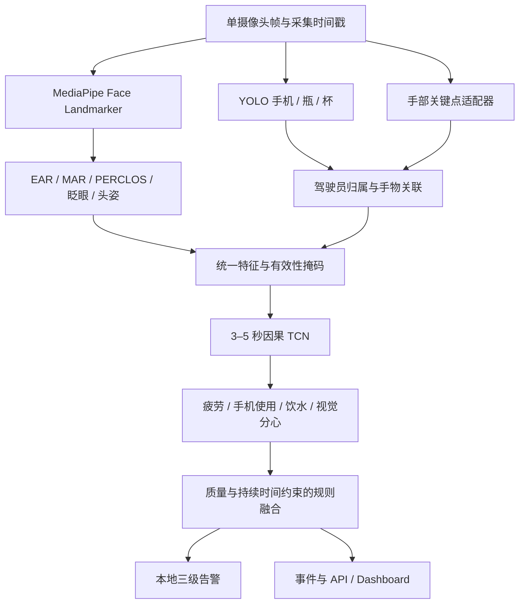

# DriveGuard AI 完整多专家模型设计

版本：0.3.0 · 状态更新：2026-09-19 · 算法负责人：shadow · 状态：TCN、感知桥接及 YOLOX/MediaPipe 本地视频适配代码已实现；真实工件CPU加载与空白帧前向已通过。新增[轻量关系门控设计](RELATION_GATED_FUSION.md)，CPU模型/训练骨架已验证；真实视频、目标平台、业务告警与真实训练验收仍未完成。适配边界见[运行指南](../training/EXPERT_RUNTIME.md)。

依据：参考 PPT 第 5–8、11 页及用户的四任务、GPU/昇腾 NPU 双平台、权重公开要求。本文定义完整模型系统；[TCN 设计](../training/MODEL_DESIGN.md)只是其中的时序子模型，不再代指全部方案。

## 1. 体系与边界

采用 **YOLO 目标检测 + MediaPipe 面部感知 + 手—物体交互特征 + TCN 时序理解 + 风险融合**。这里的“多专家”指多个模型/特征模块协作，不代表已实现稀疏 MoE、可学习路由或端到端联合训练。

2026-09-19工程取舍：项目以便于部署、多平台兼容为目的，不要求论文新颖性。保留现有38通道拼接TCN，增量实现F/O/HO/FO四证据流、共享窄TCN和任务级质量门控；二者为明确版本的候选组合，不能静默互换权重。下图保留总体流程，学习层细化见[关系门控架构图](relation-gated-fusion.svg)。门控融合证据与最终风险/告警规则是不同层。

单摄像头必须兼顾面部与驾驶员手部/交互区域。面部特写看不到手时，应报告相应能力不足；不能拼接 DMD Face、Body、Hands 视角后声称单摄像头等价。多视角融合属于后续独立方案。

## 2. 专家职责与选型

| 模块 | 首版方案 | 输出/交付 | 验证边界 |
| --- | --- | --- | --- |
| 物体专家 | 当前适配 YOLOX 0.3.0 Nano/Tiny，COCO80 | phone/bottle/cup 框、分数、版本；后续微调权重与模型卡 | Nano来源/hash已记录且CPU加载通过；再发布许可pending_permission，目标平台未验证 |
| 面部专家 | 复用 MediaPipe Face Landmarker 预训练工件 | 面部关键点、可见性和提取配置 | 不默认重训，不将关键点直接视为疲劳结论 |
| 手部专家 | MediaPipe Hand Landmarker 作为首选验证方案，封装可替换适配器 | 手部关键点、手区域、归属与质量 | 这是落实 PPT 手部接触语义的工程补充；遮挡时未知，不保证单目证明真实接触 |
| 特征模块 | 几何计算、时序统计与手物关联 | 版本化特征、mask、年龄、覆盖率 | 规则本身不称为训练模型 |
| 时序与证据融合 | 已有拼接TCN；新增四流共享窄TCN/任务门控设计 | JSON、共享模型、GPU/NPU入口、checkpoint、质量profile | 四类共存/未知标签掩码监督；新门控CPU合成训练/续训已通过，不端到端重训感知 |
| 决策模块 | 规则/加权融合与告警状态机 | 分数、质量、原因、三级风险 | 位于行为输出之后，与前述学习式证据门控分开，仍待实现 |

MediaPipe 的面部与手部是独立任务，不应把 Face Landmarker 当作自带手部接触或 gaze 行为输出的模型。[Face Landmarker 官方说明](https://ai.google.dev/edge/mediapipe/solutions/vision/face_landmarker)、[Hand Landmarker 官方说明](https://ai.google.dev/edge/mediapipe/solutions/vision/hand_landmarker)。

### 2.1 YOLO 训练协议

- 初始业务类别为 `phone/bottle/cup`，将上游预训练类别映射为稳定业务名；香烟等新增类别需独立标注与评估后启用。类名、ID 顺序和映射写入配置，不能跨权重重排。
- 先评估预训练检测器，再按座舱小目标、遮挡和背景误检决定微调。检测输入分辨率 640 为起始候选，不是最终性能保证。
- 检测清单应记录主体、录制、视角、帧时间、图片相对路径与标注状态；YOLO 标注采用 `class_id cx cy w h`，坐标相对图片宽高归一化。框越界、负面积、类别越界须拒绝。
- DMD 行为区间/gaze 标签不能自动充当检测框。恢复数据任务后核对是否存在可用 bbox；缺失时单独标注或使用可授权检测数据。没有完成标注的图片不能直接视作空框负例。
- 验证逐类 Precision/Recall、mAP50、mAP50-95、小物体/遮挡/副驾驶背景切片及延迟；检测成绩与行为 F1 分开。
- 计划目录 `training/detector/`：模型适配器、公共训练逻辑、`gpu_train.py`、`npu_train.py`、评估/导出脚本；公共 JSON 与平台配置分开。昇腾适配需要核实选定实现的训练算子、后处理及导出路径，不能以 torch_npu 可导入推定 YOLO 已兼容。
- 首轮单卡 FP32；两平台同一结构、数据语义、损失和评估口径，平台差异收敛到适配层。YOLO 上游代码/预训练权重许可独立核对，不自动套用仓库 MIT。当前参考 [YOLOX 0.3.0](https://github.com/Megvii-BaseDetection/YOLOX/tree/0.3.0)及其[代码许可](https://github.com/Megvii-BaseDetection/YOLOX/blob/0.3.0/LICENSE)；不能将代码许可直接当作具体权重再发布许可。

### 2.2 面部、头姿与 gaze

- EAR/MAR 分别是眼睛/嘴部纵横比，不是 PPT 简写的绝对“眼距/嘴距”。具体关键点索引、距离公式、左右眼定义和归一化写入 `extractor_profile`，训练与部署共用。
- 闭眼判据只在训练/验证阶段确定。PERCLOS、连续闭眼与眨眼频率使用过去有效观测，记录统计窗口和缺失比例；PPT 的 0.2 秒/1 秒为示例，不作为所有驾驶员通用阈值。
- 头姿由关键点与几何/变换适配器计算；坐标轴、旋转顺序、相机参数、镜像处理和角度单位须明确。几何不可解时输出无效。
- **头部朝向不等于视线方向**。首版视觉分心只能在已验证的头姿/交互证据范围内报告。真正的注视区域预测、眼动或独立 `eyes_off_road` 事件属于待实现扩展，不把 gaze 真值输入模型，也不宣称已经覆盖仅眼球转动的分心。

### 2.3 手—物体交互

先锁定驾驶员 ROI 与手部归属，再在同一帧坐标系中关联手区域和物体框。候选特征包括最近手物距离（按驾驶员 ROI 对角线归一化）、手区域与物体框重叠程度、归属置信度、连续邻近时长；饮水同时参考物体到嘴部距离与姿态。

这些是视觉邻近/交互证据，不是触觉接触真值。需要反例：背景手机、副驾驶持物、手机支架、杯子静置、拿杯但未饮水。手不可见或归属不明时 mask=0，不可把“没看见手”当作“确定未使用手机”；头姿不能作为所有手机使用正例的必要低头条件。

## 3. 统一输入与时序协议

| 内部契约 | 必要内容 |
| --- | --- |
| 帧/专家观测 | session/frame ID、采集 UTC、单调时间、原图尺寸、模型版本、处理延迟、质量、错误 |
| 检测/关键点 | 原图坐标约定、类别/索引版本、候选身份及驾驶员归属；缩放/裁剪/镜像的逆变换 |
| 特征协议 | 有序通道、单位、有效性 mask、来源模型、最大观测年龄、统计上下文、profile hash |
| 时序输入 | 现有基线`[B,T,2F]`；新门控按固定分组增加质量/资格输入，须新schema；同录制/同视角、无未来插值 |
| 行为输出 | 固定四类 logits、独立 sigmoid、task_available、覆盖率；不直接等于校准置信度 |

TCN 默认 25 Hz、4 秒（100 步）。旧 12 个观测+12 个掩码的 **24 通道方案仅是基线/消融配置**，缺少明确的手部交互和眨眼频率通道，不能当作 PPT 完整输入验收。完整 profile 至少评估补入眨眼频率、手机/饮水物体的手物距离/重叠与持续时长；F 由最终有序 schema 推导，不能修改通道后仍沿用旧 checkpoint。

新增特征需同步提取器、缓存、normalizer、模型输入层、权重 manifest 和推理适配。已有[19特征/38通道候选](../training/PERCEPTION_BRIDGE.md)及保守跟踪、真实工件CPU调用；参数标定、自动归属/头姿与真实视频验收尚未完成。新门控复用19字段的定义，额外记录观测年龄/依赖profile，不从旧缓存猜测缺失元数据，不称为已验证完整profile。

各专家允许不同推理频率，但必须按采集时间对齐。TCN 基线最大观测年龄 80 ms 是候选值；降低 YOLO 频率时须重新评估年龄/mask 分布，不能无限沿用旧框。25 Hz 采样、10 Hz 状态推送和视频预览帧率不是同一指标。

## 4. 四任务与数据设计

保持 `fatigue / phone_use / drinking / distraction` 四类，多标签而非四选一。来源 Gaze/Drows/Dist 与标签分开；无标注类别使用 label_mask=0。主体划分覆盖所有子集和视角。详细损失、采样与恢复协议见 [TCN 子模型设计](../training/MODEL_DESIGN.md)。

当前下载为 Gaze 两片、Drows 一片、Dist 一片，未完成、未核对实际覆盖；本轮不恢复数据任务。原论文多模态/多视角范围不等同于当前可下载内容，以[官方发布说明](https://github.com/Vicomtech/DMD-Driver-Monitoring-Dataset)和实际清单为准。200 GB 预算下只缓存录制级特征，不复制重叠窗口、不全量抽帧。

## 5. 风险融合与解释

完整四任务的候选加权分数为 `S = sum(w_c * p_c) / sum(w_c)`，c 覆盖四类可用任务，w 非负且分母大于零；S 是策略分数，不是事故概率。PPT 的三项公式只作示意，不能漏掉 drinking。仅在对应质量配置成立时参与等级判断；未训练/不可用任务从 risk_scores 省略，不伪造为 0。

等级由分数阈值、单任务高风险规则、持续时间与恢复滞回共同决定。疲劳与视觉分心相关，必须用消融/回放检查重复加权；严重单项风险不能被其他低分稀释。阈值、持续时间、权重、缺失策略写入版本化融合配置，只在验证集调参。

- 部分任务不可用但有充分危险证据：允许 WARNING/DANGER，quality=degraded，并列明缺失原因。
- 完整已验证能力与覆盖满足要求，且无有效危险证据：才可输出 SAFE。
- 窗口未满、全输入缺失，或剩余证据不足以判断：无有效风险快照，仅报告不可用状态，不用 SAFE 占位。
- `RECOVERING` 是告警内部状态，不增加第四种公开风险等级；感知不可用提醒与危险行为告警区分。
- `reason_codes` 对应可观测证据/缺失状态，不宣称因果解释。PPT 的 0.91/0.82/0.12 是展示示例，不写进实验成绩。

## 6. 模型组合与训练交付

一个 `model_bundle_version` 对应不可变 manifest，绑定 detector、face/hand landmarker、temporal、fusion 的版本/校验和，以及类别映射、特征 profile、normalizer、标签顺序与运行时环境。权重/规则单独登记，整个兼容组合一起激活或回滚，不能只换 YOLO 却保留旧特征缓存不核对。

shadow 交付可训练模块的 GPU/NPU 两入口、公共配置、训练/评估记录、可重建模型、best/last CPU state_dict 和模型卡；复用的 MediaPipe 工件交付来源、版本、许可、hash 和调用 profile，不冒充自训成果。正式权重必须公开；来源许可未明确时记录 pending_permission 并解决，不用“代码已开源”替代权重交付。具体见[职责约定](../training/TRAINING_CHARTER.md)。

## 7. 分层验收

1. 感知：检测框质量、关键点有效率、归属/交互反例、同步误差和各专家耗时。
2. 时序：因果性、mask/label_mask、主体独立评估、四任务 P/R/F1、可用任务集合。
3. 融合：单项严重风险、多风险重复计数、缺失输入、持续时间、恢复与冷却。
4. 系统：完整视频到告警/事件/UI 的连续回放；每小时误报、危险行为召回、检测延迟、持续 FPS 和稳定性。

部署选型首先比较现有38通道基线与关系门控候选，保持相同主体划分、输入证据和设备口径；单帧/24通道及更细消融按排错需要开展，不把论文式实验作为每次迭代门禁。分别报告误报/漏报、可用率、延迟与资源代价；无收益则保留简单基线。尚无真实跑分，不能据架构名称断言提升幅度。
