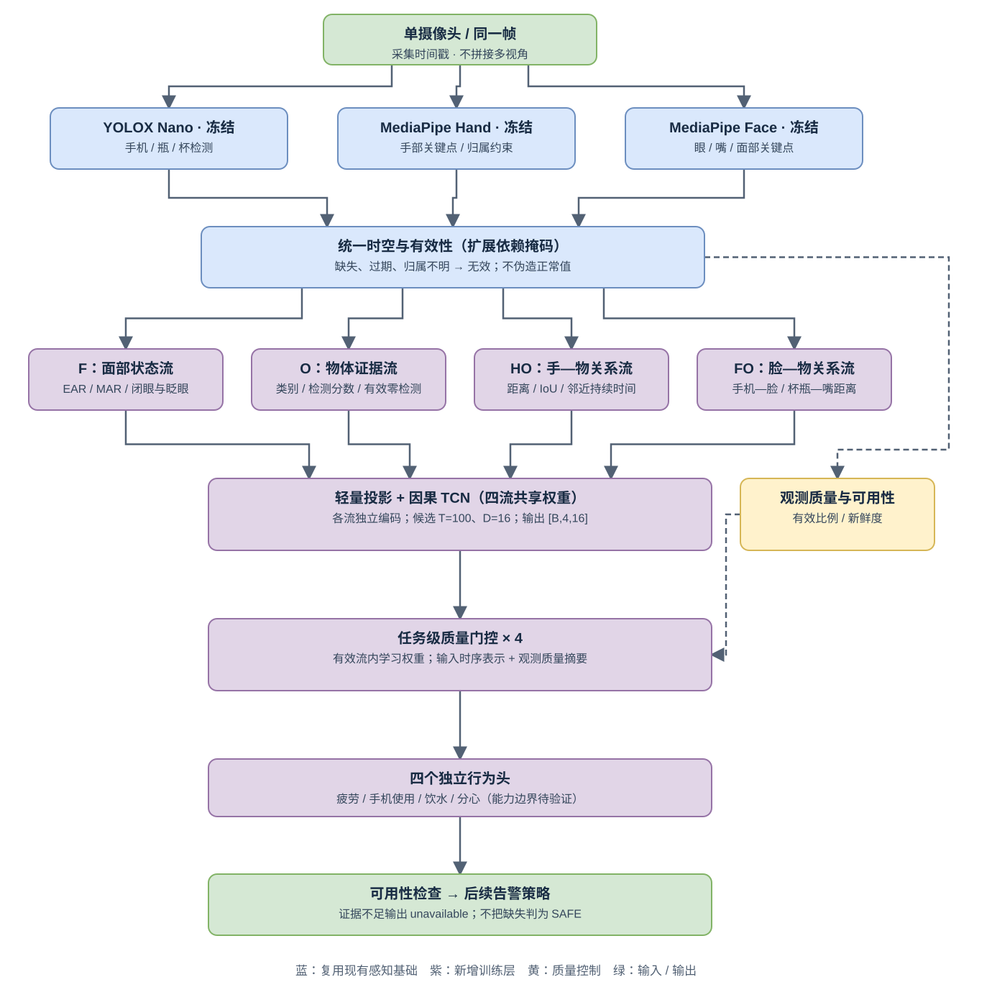

# 轻量关系门控融合设计

2026-09-21增量：本文保留原19特征四任务基线。新版 `relation_gaze_v1` 在F组追加四个虹膜字段，并启用头姿估计；共23特征/46通道，四流仍共享同一TCN。九分类gaze头读取F流表示，其损失参与更新共享编码器，不是独立部署第五个感知专家。原四个行为门控头保留。实现、质量屏蔽和训练命令见[四行为+Gaze指南](../training/GAZE_FULL_RUNBOOK.md)；旧图描述原四任务结构，不包含新增辅助头。新版已做本机CPU工程验证，尚无真实全量/NPU联合训练结论。

版本：0.2.0 · 2026-09-19 · 负责人：shadow · 状态：**模型骨架、v2特征契约和共享训练已实现，CPU合成训练/续训/重载通过；真实数据、GPU/NPU及完整部署未验证**。

实现入口与服务器命令见[关系门控训练指南](../training/RELATION_RUNBOOK.md)，本轮范围见[代码实施计划](../training/RELATION_IMPLEMENTATION_PLAN.md)。

用户确认采用关系门控方向，并明确优先级为：**便于部署、多平台兼容、实际效果与维护成本，不以论文创新为目标**。本文细化工程方案，不承诺精度提升、平台已兼容或已完成训练。关联 Spec：REQ-003、009、011、012、013。

## 1. 决策与范围

| 选项 | 收益与代价 | 决策 |
| --- | --- | --- |
| 现有19特征/38通道拼接TCN | 实现已存在、排错简单；没有任务级门控 | 保留为参考与回退方案，不称为已训练部署模型 |
| 四证据流 + 共享窄TCN + 任务门控 | 利用手—物、脸—物关系，增加少量训练层和数据质量字段 | CPU骨架已实现；真实数据实测有价值才用于部署 |
| 大型图网络、Cross-Attention、端到端重训 | 多候选交互更灵活，但数据、计算、导出和维护成本更高 | 本阶段不引入 |

保留单摄像头、四任务、GPU/昇腾双训练入口、权重公开要求。首阶段冻结三个预训练感知模型，仅训练投影、时序编码、门控与分类头。门控不能弥补画面看不到手、头姿/眼动未实现或数据缺少监督；检测器微调仍是后续按错误分析决定的独立工作包。

不新增框架、图计算库、自定义CUDA/NPU算子、专家调度服务或分布式训练。不恢复DMD下载/处理、不追加远程硬件排查。新模型使用独立v2配置与training.relation入口；旧v1配置/入口保持不变。

## 2. 架构与职责

[可编辑图源](relation-gated-fusion.drawio)。图中紫色训练层及依赖mask/质量预处理已有代码并通过CPU合成验证；绿色告警/业务任务可用性仍是后续设计，蓝色感知的真实视频效果仍待验收。

1. 感知适配层：YOLOX输出物体，MediaPipe输出脸和手；统一原图坐标、采集时间与驾驶员归属。不把Face任务当作自带gaze/手部模型。
2. 特征契约层：保留几何定义，显式传播缺失与过期状态，形成四条固定顺序证据流。该层是可测试规则，不是额外预训练模型。
3. 学习层：四个小投影、一个共享权重的窄因果TCN、四个任务门控与分类头。参数更新不穿过YOLOX/MediaPipe。
4. 输出适配层：结合已训练任务和观测覆盖判断可用性，再交给独立的风险规则/告警状态机。神经网络融合不代替持续时间、恢复滞回和严重单项风险规则。

### 2.1 固定四条证据流

复用现有[interaction_v1定义](../../configs/perception/interaction_v1.json)，首版不增加原始关键点序列或中间图像特征：

| 顺序/标识 | 特征（组内顺序固定） | 来源依赖 |
| --- | --- | --- |
| 0 / F | ear_left、ear_right、mar、perclos_4s、closed_duration_s、head_yaw_deg、head_pitch_deg、head_roll_deg、blink_rate_per_min | Face及历史有效观测 |
| 1 / O | phone_conf、drink_object_conf | Objects；成功的空检测是有效零，不等于推理失败 |
| 2 / HO | phone_hand_distance、phone_hand_iou、phone_near_duration_s、drink_hand_distance、drink_hand_iou、drink_near_duration_s | Hands + Objects、同帧坐标/归属与历史关联 |
| 3 / FO | phone_face_distance、drink_mouth_distance | Face + Objects |

19个字段只分组，不悄悄修改含义；当前尚无头姿求解时三个head字段继续mask=0。训练中从未有效的字段保持supported=false，不在部署时擅自启用。Hand通过HO参与融合，不必为凑专家数再建立独立手部大网络。

同一证据可能影响多个任务，但四类输出是独立sigmoid，不做四选一。HO/FO仅描述视觉关系，不是物理接触真值。

### 2.2 缺失传播先于门控

- Face失效：F内受影响字段、FO相应字段失效；HO不因脸部字段缺失一概失效，但仍必须满足既有驾驶员归属条件。
- Hands失效或归属不明：HO相应字段失效；F与O仍可保留。
- Objects失败/过期：O、HO、FO受影响字段失效。成功但没有目标时O保持有效零，距离等无目标字段仍未知。
- 连续邻近/闭眼等统计在证据中断、对象切换时按原profile重置或标未知；恢复时不能沿用遮挡前的计时起点。
- 非法工件、hash/schema不匹配仍明确报错，不能包装成普通遮挡后继续运行。可恢复观测缺失与程序/安装错误分别记录。

依赖按字段和历史状态定义，不只做整个组乘0。物体位于ROI并不自动证明属于驾驶员，门控不能覆盖归属未确认的mask。

## 3. 最小网络设计

以下配置已在[relation_gated.json](../../configs/training/relation_gated.json)落地：

| 项目 | 首轮设计 |
| --- | --- |
| model_kind | v2配置model.kind=relation_gated_v1；旧v1由工厂隐式识别temporal_tcn_v1，旧JSON不加键 |
| 输入窗口 | 25Hz、T=100；四组数值及同形mask，复用训练主体normalizer |
| 投影 | 每组Linear(2F_i,16)+ReLU，四组参数独立 |
| 共享编码器 | 五个因果残差块，通道均16、kernel=3、dilation=1/2/4/8/16；两层卷积/块；dropout=0.1仅训练启用 |
| 共享方式 | 将四流折叠到batch轴，输入[B×4,100,16]；分别编码，取末槽后还原[B,4,16] |
| 门控 | 每任务输入四流时序向量及8维质量摘要，Linear(72,16)+ReLU+Linear(16,4) |
| 任务头 | 每任务对加权16维向量做Linear(16,1)；返回固定顺序[B,4] logits |
| 数值精度 | FP32参考；初始不引入AMP、量化、torch.compile或平台专用融合算子 |
| 规模目标 | 默认可训练部分实测13,524参数（目标<100,000）；不含冻结感知模型 |

共享TCN权重减少参数，但仍计算四条流，不等于只计算一条流；总耗时必须测量。预处理/校验在数值图外，图内优先固定形状的Linear、Conv1d、显式左padding、ReLU、加法、reshape、softmax、乘法、reduce和clamp。常见算子不等于目标NPU/导出器已经支持该组合。

新编码器复用现有因果残差块的构造原则，不把投影后的16维向量直接传入要求values+mask成对输入的旧TCN公开接口；两种模型通过后续模型工厂明确区分。

### 3.1 质量摘要与数值安全

首版仅使用能从观测和mask得到的两个量，不另训“质量网络”，不虚构关键点置信度：

- `valid_ratio`：窗口内该流有效字段数 / (T × 该流supported字段数)。分母为0时取0；supported集合固定随normalizer发布。
- `freshness`：末槽该流所需原始专家的最大观测年龄a，以`max(0, 1-a/max_age_ms)`归一；缺失/未知取0。HO依赖Hands和Objects，FO依赖Face和Objects；必须先应用原始mask。年龄在max_age边界上可能为0分但尚有效，门控资格不直接等同于该分数。

初始资格规则：该流至少一个supported字段、末槽至少一个有效字段、valid_ratio达到候选0.5，且原始观测满足profile最大年龄。0.5是验证集调整的起点，发布时固定到组合配置；不能用它证明某行为已经可判断。质量摘要和资格从同一window/profile计算，训练与部署不得各写一套。

先将不合格流的时序向量置零，再构建门控输入，避免失效历史间接改变其他流权重；质量摘要保留用于诊断输入。对每个任务c，在有效流上归一门控权重alpha_ci，z_c=sum(alpha_ci × h_i)。数值实现先用有限负常量屏蔽无效logit，softmax后再次乘资格mask，并以clamp后的权重和重新归一；全无效时权重与z均为0且标记不可用，不向用户展示分类头bias产生的分数。该路径必须覆盖混合batch中“部分样本全缺失”的情况，不采用整批Python提前返回。

门控权重只是融合诊断，不是校准置信度、因果解释或危险程度。soft门控不跳过上游模型，不能宣称节省YOLOX/MediaPipe计算。

### 3.2 任务可用性与告警

训练时仍对已知且启用的行为标签使用masked BCE；全无输入的样本不更新行为参数，但保留覆盖/丢弃计数。全无有效监督的batch/epoch沿用[数据契约](../training/DATA_CONTRACT.md)和REQ-012规则。

运行时任务可用性至少同时满足：任务已训练、窗口就绪、至少一个有效证据流，以及模型卡规定的已验证支持范围。缺失组合能否用于判断须由回放验证记录，而非自动假设“还有O就能识别饮水”。发布组合必须声明各任务获准使用的证据组合；未验证组合按不可用处理。

未实现/验证头姿或眼动时，不因保留distraction输出就宣称覆盖完整视线分心。无可用结论不生成SAFE；部分任务不可用但有充分危险证据时，遵守现有degraded WARNING/DANGER规则，不自动清除既有告警。

## 4. 数据与训练成本

新模型需要额外的原始专家观测年龄及分组profile，不能从旧values/masks反推出年龄。新增录制格式见[数据契约的关系门控扩展](../training/DATA_CONTRACT.md#6-关系门控扩展)。旧v1保持可读且不可原地改名冒充新格式。

首阶段缓存录制级特征即可训练，不缓存图像特征图、不重复落盘重叠窗口；有条件的机器负责提取，再传递带hash的特征、标注和主体清单到训练服务器。NPU训练服务器不必为了训练融合层同时安装MediaPipe/YOLOX；不能因此推定该服务器具备视频感知运行能力。

首轮损失只有masked BCE。不引入对比学习、蒸馏、多套辅助头或新的质量标签。可选稳健性增强仍待后续实现，本轮不提供该配置开关；设计规则为：模拟连续区间内某专家缺失，同步失效其全部派生字段、重算受影响历史统计与质量摘要。缓存字段不足以精确重算时，保守屏蔽受影响统计到完整统计窗口恢复，不保留完整观测泄漏；该增强不改变行为标签，但没有足够输入的样本不算有效训练样本。不在首版同时添加任意噪声、时钟扰动和遮挡合成。

原始录像遮挡测试与特征级缺失测试分别报告。验证/测试不应用随机增强，不改变主体划分或未知标签语义；subset/view名称、标签可用模式和真值不输入门控。

## 5. 多平台与部署边界

原则是**共享模型/数据语义，隔离平台依赖，按实际平台验证**，不是承诺一个虚拟环境或engine到处运行。

| 层 | CPU参考 | NVIDIA GPU | 昇腾NPU | Jetson/其他目标 |
| --- | --- | --- | --- | --- |
| 新融合网络训练 | 已完成合成训练、续训与best重载 | 共用PyTorch结构和循环，CUDA入口，待验证 | 共用结构/循环，torch_npu入口，待验证 | 不要求在边缘端训练 |
| 新融合网络推理 | 特征窗口前向/重载已验证；完整视频告警适配待实现 | 先PyTorch；需要时另验证导出 | 仅在明确需要NPU推理时适配；当前非交付承诺 | 先验证可运行组合，再按瓶颈优化 |
| YOLOX视频感知 | 本机加载/空白帧已通过 | 适配代码不等于实机通过 | 当前YOLOX检测后端已拒绝NPU；检测器训练/推理另行适配 | 分辨率、预后处理、时延逐项验证 |
| MediaPipe Face/Hand | 本机CPU已加载；真实视频待验证 | 可以保留CPU，不强制GPU化 | 不要求运行在NPU，也不把服务器能训练等同可安装MediaPipe | aarch64依赖/delegate与性能另验收 |

沿用已工作的训练环境，不自动升级torch/CANN。`requirements.txt`、`requirements-npu.txt`、独立感知依赖分别维护；现有Windows CPU版本快照不得当成Linux/aarch64锁文件。

训练入口请求GPU/NPU而不可用时明确失败；CPU必须显式选择。推理允许部署配置明确指定“MediaPipe CPU + 检测器GPU + 融合CPU/GPU”，这不属于静默回退；记录每个组件实际backend。只有目标平台测试通过的组合才标为支持。

ONNX是可选交换格式，TensorRT是NVIDIA目标优化路径，不强制每个平台都走一遍。先用固定B=1/T=100/四流FP32小图验证导出和数值，再考虑动态batch/FP16；此顺序是本项目选择，不是官方兼容保证。导出环境与已工作的感知环境隔离，不为此消除YOLOX现有ONNX依赖声明警告。TensorRT engine随目标环境构建，不作为通用权重。

## 6. 部署包与回退

一个版本组合绑定：三个感知工件及hash/许可、特征/依赖profile、normalizer、模型类型与超参数、CPU state_dict、四任务顺序与active_tasks、任务支持组合、风险规则、平台环境记录。门控不新增公共API字段或数据库枚举；内部诊断需要对外暴露时再同步OpenAPI。

保留现有temporal_tcn_v1组合与新relation_gated_v1组合。现通过明确的模型类型选择，不把选择键直接塞入当前严格v1配置解析器。切换/回退以完整组合进行，清空窗口与计时器并进入预热；不沿用不匹配缓存/normalizer。设备失败时不擅自改模型或backend，需操作者显式选择已验证组合。

只有实际发布的格式写入manifest；未导出ONNX/TensorRT写未产出而非伪造路径。正式训练权重仍必须公开，许可不清仍pending_permission；当前本地YOLOX工件不等同本项目已公开的训练成果。

## 7. 实施顺序与验收

按可独立验证的小增量推进，不增加论文式实验或额外审批：

1. **契约与预处理**：确定分组、依赖mask、年龄记录、质量计算和新旧schema拒绝混用；先做纯CPU合成边界测试，不读DMD。
2. **模型与训练接线**：实现共享小模型/模型工厂，复用双入口、loss、normalizer和checkpoint；新增字段不得破坏旧配置/旧模型读取。分别验证因果性、有限梯度、全缺失、参数量和CPU恢复。
3. **平台小闭环**：同一固定输入、初始化state_dict和训练配置，在实际可用CPU/GPU/NPU上验证前向/反向/更新、保存再加载；无硬件记未验证，不让本地设计推进等待远程设备。
4. **真实输入与效果**：用户恢复数据任务或选定短视频后，先核对坐标/归属/覆盖与标注，再小样本训练并比较现有38通道基线。一次只增加一个变化；不默认要求多种子大规模消融。
5. **部署选择**：同一目标硬件、数据、阈值选择流程下比较误报/漏报、可用率、内存和P50/P95总延迟；收益不值成本就保留基线。只有定位到瓶颈才新增ONNX/TensorRT/低精度优化。

至少覆盖：手失效而F保留、物体失败与空检测区别、关系统计跨缺失重置、全无效样本混合batch、训练从未支持的头姿、未训练任务、模型/schema不匹配、专家年龄超过80ms、请求NPU却无设备、组合回退后预热。

固定样本FP32跨runtime数值检查以CPU为参考，初始对logits采用`atol=1e-4, rtol=1e-3`，mask/可用性必须完全一致；这是拟验收容差，未实测，不满足时先定位差异，不能静默放宽或只比较最终类别。不同设备独立训练轨迹不要求逐位一致，恢复优化器状态与训练步数单独检查。

业务报告同时给出可用率、不可用时长和包含不可用区间的已标注危险事件漏检，不能靠拒绝所有输入降低误报。没有完整事件标注时只报窗口指标；不能虚构每小时误报。完整持续25FPS仍是项目目标，未确定目标硬件前不承诺达到；接口、推理和采集耗时分开记录。

## 8. 当前状态与追溯

- 已有：19特征提取、缺失mask、TCN工程、双入口、三个预训练工件本机加载；证据见[准备记录](../training/PERCEPTION_SETUP.md)。
- 本轮：四流门控网络、v2配置/manifest/年龄导出、质量与历史依赖过滤、模型工厂、CPU/GPU/NPU入口、共享训练/重载/续训和CPU合成工具已实现；未安装依赖或连接服务器。
- 尚需：真实标注映射/回放/训练、硬件验证、可选缺失增强、业务任务支持范围和完整告警适配、正式权重交付。raw available仅表示存在合格证据，不等同于业务任务已经验证。
- 取舍撤销条件：关系门控不能在目标成本下改善业务表现，或关键平台无法可靠支持；保留基线，不为架构名称持续增加复杂度。

来源：2026-09-19用户确认；[现有视频入口](../../inference/perception/video.py)、[几何特征](../../inference/perception/geometry.py)、[现有TCN](../../training/temporal/model.py)、[数据契约](../training/DATA_CONTRACT.md)、[项目Spec](../specs/PROJECT_SPEC.md)。

平台说明核对于2026-09-19：[PyTorch 2.7 ONNX](https://docs.pytorch.org/docs/2.7/onnx.html)、[Ascend兼容矩阵](https://github.com/Ascend/pytorch/blob/master/COMPATIBILITY.md)、[MediaPipe Python安装说明](https://developers.google.com/edge/mediapipe/solutions/setup_python)、[TensorRT支持矩阵](https://docs.nvidia.com/deeplearning/tensorrt/latest/getting-started/support-matrix.html)。这些是适配依据，不替代锁定环境实测。
