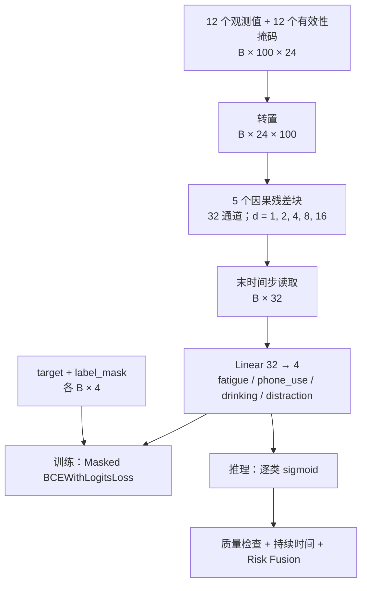

# DriveGuard Temporal v1 模型设计

版本：0.1.0 · 负责人：shadow · 分支：`model` · 日期：2026-09-18。

状态：完整任务方向已确认，本文是待评审的详细设计，不代表模型代码、正式训练或硬件性能已经完成。

## 1. 范围与已确认条件

- 保留疲劳、手机使用、饮水、视觉分心四类目标，不将项目缩减为 gaze 分类。
- 用户正在下载 Gaze 两个分片、Drows 一个分片、Dist 一个分片。下载未完成；分片名、主体、标签和视角覆盖尚未核对。分片数不能作为数据完整性的证据。
- 本轮搁置数据下载、解压、标注扫描、真实训练和追加服务器测试。先完成可独立开发的模型结构、输入输出、损失和工件设计。
- 训练 GPU/NPU 共用模型；NPU 基线为 910B3、CANN 9.0.0、PyTorch 2.7.1+cpu、torch_npu 2.7.1.post4、Python 3.11.4。用户只验证了小型 Linear 模型的前向、反向与参数更新。
- 200 GB 磁盘预算下不要求原始视频全量常驻、不展开全部视频为图片、不重复保存重叠窗口。视频下载方案不在本轮变更范围。
- 四任务是交付目标，不承诺尚未核对的数据已经足以训练全部任务。正式权重开源要求与来源许可核实沿用[训练职责约定](TRAINING_CHARTER.md)。

## 2. 方案取舍与模型边界

| 方案 | 本项目取舍 |
| --- | --- |
| 预提取观测特征 + 轻量因果 TCN | 采用。符合已有架构，可复用特征缓存，训练时无需反复解码视频，便于控制资源预算 |
| 相同特征 + GRU | 后续对照实验候选；首版不同时维护第二套时序网络 |
| 原始视频 + 3D CNN / Video Transformer | 暂不采用；引入视频解码、视觉编码器训练和更复杂的资源管理，超出首批范围 |

这是一项工程选型，不是 TCN 精度优于其他方案的实测结论。

感知层提供人脸、头部和物体观测；TCN 只负责从连续观测学习行为；风险融合负责持续时间、冷却、可靠性和 SAFE/WARNING/DANGER。TCN 不直接输出风险等级，也不把 sigmoid 数值叫作已校准的置信度。

首批仅实现 TCN 和预提取特征接口。YOLO 版本选择/微调、特征提取器、独立 gaze 区域分类器及 ONNX 导出分别作为后续工作包，不在 TCN 主干中隐藏这些功能。

MVP 仍是单摄像头：一个样本只能来自同一录制的一个视角。不能用 Face 视频的眼部特征加 Body 视频的物体特征组成训练样本，再宣称单摄像头部署等价。同一主体的全部分片、录制与视角必须属于同一个数据划分。

## 3. 输入：观测与有效性分开

### 3.1 张量契约

- 特征版本候选：`driveguard-observation-v1`。
- 时间采样：25 Hz；默认窗口 4 秒，即 `T=100`；模型接口输入 `x: float32[B,T,24]`。
- 通道布局：前 12 个是标准化后的观测值，后 12 个是同顺序的 0/1 有效性掩码。
- 模型内部转置为 `[B,24,T]`；输出原始 logits `[B,4]`。
- 首版训练窗口固定长度；推理累积 100 个采样槽之前报告 `warming_up`，不把补零短窗口当成安全结论。
- 25 Hz 特征采样不代表整条系统已达到 25 FPS。首版模型每个采样槽可执行一次，实际频率与延迟以部署实测为准。

### 3.2 观测通道候选

| 索引 | 名称 | 原始语义/单位 |
| --- | --- | --- |
| 0 | `ear_left` | 驾驶员左眼的眼睛纵横比，无量纲 |
| 1 | `ear_right` | 驾驶员右眼的眼睛纵横比，无量纲 |
| 2 | `mar` | 嘴部纵横比，无量纲 |
| 3 | `perclos_4s` | 过去 4 秒有效眼部观测中的闭眼比例，0–1 |
| 4 | `closed_duration_s` | 截至当前槽的连续闭眼秒数 |
| 5 | `head_yaw_deg` | 头部 yaw，度 |
| 6 | `head_pitch_deg` | 头部 pitch，度 |
| 7 | `head_roll_deg` | 头部 roll，度 |
| 8 | `phone_conf` | 当前视角手机候选的最高检测分数，0–1 |
| 9 | `drink_object_conf` | 当前视角瓶/杯候选的最高检测分数，0–1 |
| 10 | `phone_face_distance` | 最高分手机框中心到面部框中心的像素距离 / 面部框对角线 |
| 11 | `drink_mouth_distance` | 最高分瓶/杯框中心到嘴部中心的像素距离 / 面部框对角线 |

以上是 TCN 接收的观测语义，不是已经实现的特征提取算法。距离候选与置信度候选必须对应同一物体；同分时使用提取器定义的确定性顺序。距离只提供交互线索，不能证明手机正在使用或瓶中液体正在被饮用。

真实特征接入时，`extractor_profile` 必须明确关键点索引及 EAR/MAR 公式、坐标系/欧拉角旋转顺序、闭眼判据、物体类别/筛选阈值和模型版本；缺少该配置的缓存禁止用于正式训练。此处不猜测具体分片或提取器的坐标约定。更换定义必须升级 profile/hash；不能仅保持通道名不变。

### 3.3 缺失、采样与归一化

- 特征生产者在时刻 t 只能使用时间戳不晚于 t 的观测；使用最近的过去观测，默认允许最大年龄 80 ms，过期标记缺失。不从未来帧插值，不跨录制补齐。
- 提取成功但未检测到手机：`phone_conf=0, mask=1`；检测器失败：`phone_conf=0, mask=0`。没有手机候选时，手机距离无定义，距离 mask 为 0。饮水物体同理。
- 眼部缺失时不得假设闭眼或睁眼。连续闭眼时长遇到缺失后不再知道真实起点；直到观测到睁眼或新的完整闭眼起点才恢复有效。PERCLOS 需要满 4 秒历史、有效比例至少 80%，否则 mask=0。闭眼判据属于 extractor_profile，并只在训练/验证阶段选择。
- PERCLOS 使用自身的过去 4 秒上下文，因此整体观测链可依赖超过 TCN 单个 4 秒窗口的历史；这不构成未来泄漏。训练和推理都从同一录制历史计算。
- 每通道均值和标准差仅从训练主体的有效、唯一时间槽拟合，避免滑窗重复加权；标准差下限 `1e-6`。验证/测试/推理复用相同统计。
- 有效值标准化后截断至 `[-5,5]`；无效值最后填为 0，并保留 mask=0。掩码不做标准化，NaN/Inf 不允许进入模型。
- 训练集从未观测到的通道记录为 `unsupported`，均值=0、标准差=1；该版本对该通道始终使用 mask=0，不能在部署时突然启用未训练的特征。
- 另存原始掩码和覆盖率供质量判定。掩码进入模型不等于模型一定能正确处理所有缺失情形。

## 4. 输出与部分标注

### 4.1 固定类别顺序

标签版本：`driveguard-behavior-v1`；顺序固定为：

1. `fatigue`：协议定义的疲劳相关状态，不是医学诊断。普通眨眼、单次打哈欠不自动等同于疲劳。
2. `phone_use`：手机交互行为，不是手机物体存在。
3. `drinking`：饮水动作，不是瓶/杯物体存在。
4. `distraction`：视觉注意力偏离的行为目标，不是所有危险行为的总标签；gaze 区域到该目标的映射须保留驾驶相关注视的区别。

四类可同时成立，使用独立 sigmoid，不使用四选一 softmax。没有单独的 `safe` 类；某个输出低分、四类未知或输入不可用，都不能直接推导 SAFE。

### 4.2 标签契约

每个窗口包含 `target: float32[4]` 与 `label_mask: bool[4]`。已确认正例是 `(1,1)`，已确认负例是 `(0,1)`，未知是 `(0,0)`；未知位置的 0 只是有限占位值。

窗口目标描述最后一个采样槽对应时刻的行为状态，前面的窗口仅提供历史。禁止用“整个窗口任意一帧出现过该行为”替代该语义。时间段统一为半开区间 `[start,end)`；只在末时刻有有效、无歧义标注时启用对应 label_mask。

- Gaze、Drows、Dist 是来源信息，不是整段样本的类别标签；不得将来源名输入模型。
- Gaze 样本没有疲劳或手机标注时，相应 label_mask=0；不能补为负样本。
- 同一标注层在该时间段确实穷尽且类别互斥时，才可按记录好的映射得到负例；“JSON 中没有这一标签”本身不够。
- Gaze 的后视镜/侧窗注视不能一概标为危险；缺少上下文的歧义区域使用未知标签。`not_valid` 不映射为安全。
- 每次真实训练必须提供版本化 `label_mapping`：原始标签、目标类别、正/负/未知规则、歧义处理、标注覆盖范围与文件哈希。具体原始标签映射留给数据恢复任务核对，不凭分片名编造。
- 不将 ground-truth gaze 标签作为输入特征。未来若接入 gaze 预测，只能使用可部署的预测器输出，并同步升级特征协议。

### 4.3 可用任务

训练配置显式声明 `active_tasks`。每个启用任务在训练集和验证集必须均有已标注正例与负例，否则终止该次配置并报告缺口，不静默降低任务数。

允许明确标记的部分任务实验，但正式四任务模型必须四类全部满足数据和评估条件。未训练任务的 logits 只是参数输出，模型卡标记不可用，推理适配器不得作为业务概率使用。

## 5. TCN 结构

候选名称：`DriveGuardTemporalV1`。输入 `[B,100,24]`，不接收原始图像。

| 层 | 配置 | 输出 |
| --- | --- | --- |
| 转置 | `[B,T,C]` → `[B,C,T]` | `[B,24,100]` |
| 残差块 1 | 24→32，dilation=1 | `[B,32,100]` |
| 残差块 2 | 32→32，dilation=2 | `[B,32,100]` |
| 残差块 3 | 32→32，dilation=4 | `[B,32,100]` |
| 残差块 4 | 32→32，dilation=8 | `[B,32,100]` |
| 残差块 5 | 32→32，dilation=16 | `[B,32,100]` |
| 末时间步读取 | `h[:,:,T-1]` | `[B,32]` |
| 分类层 | Linear(32,4)，四个独立二分类 logit | `[B,4]` |

每块：左侧补零 → Conv1d → ReLU → Dropout → 左侧补零 → Conv1d → ReLU → Dropout → 残差相加 → ReLU。两次卷积均为 kernel=3、stride=1、bias=True，同块 dilation 相同；每次只在左侧补 `2*dilation`。首块残差使用带 bias 的 1×1 Conv1d(24,32)，其余残差为 identity。Dropout=0.1，只在训练启用。

首版不使用 BatchNorm、跨时间归一化、双向层、自定义算子、WeightNorm 或设备专用融合算子，以减少首轮实现和迁移分支。GPU/NPU 算子实际支持及性能不由此保证。

感受野 `R = 1 + 2*(3-1)*(1+2+4+8+16) = 125` 个时间步。默认输入 100 步，超出窗口的历史由卷积左侧补零，训练和推理保持一致；不能把补零称为额外 25 帧真实上下文。

按上述层和 bias 手工计算参数量为 **31,204**，纯 FP32 参数约 **122 KiB**；这是设计计算，不是实际 checkpoint 大小或显存/速度实测。优化器、元数据与感知模型不在此数字内。

### 结构图

[可编辑 draw.io 源图](driveguard-temporal-v1.drawio)。本机未找到 draw.io CLI；源图做结构校验，尚未进行 PNG 导出和视觉验收。以下 Mermaid 为正文内嵌概览。

## 6. 训练与验证设计

### 6.1 Masked BCE

使用 `BCEWithLogitsLoss(reduction='none')` 得到每样本每类别损失 `b[i,c]`。设 `m[i,c]` 为 label_mask 与 active_tasks 的交集，先对每类已知样本求均值，再对该批有监督的启用类别等权求均值：

`Lc = sum_i(m[i,c] * b[i,c]) / sum_i(m[i,c])`

`L = mean(Lc for c with sum_i(m[i,c]) > 0)`

- 未知标签对该分类 logit 的直接损失梯度为 0；共享主干仍会受其他任务梯度影响，不承诺不同任务完全独立。
- 整批无已知标签时跳过参数更新并计数；整个 epoch 无有效更新时失败，不能把 loss=0 记录成成功训练。
- 默认 `pos_weight=1`；类别不平衡先报告已知正/负样本数，后续权重只按训练集计算并写入配置。
- 验证损失按完整验证集逐类累计分子/分母后再宏平均，不能简单平均各 batch 的平均损失。训练日志也报告相同的全 epoch 聚合口径。

### 6.2 初始超参数候选

| 参数 | 首版值 |
| --- | --- |
| sample_rate_hz / window_steps | 25 / 100 |
| input_channels / output_tasks | 24 / 4 |
| channels / dilations / kernel_size | [32,32,32,32,32] / [1,2,4,8,16] / 3 |
| dropout | 0.1 |
| optimizer / learning_rate / weight_decay | Adam / 0.001 / 0.0001 |
| epochs / batch_size / seed | 10 / 16 / 42 |
| precision / workers | FP32 / 0 |
| gradient_clip_norm | 1.0 |
| train_window_stride_steps | 25，保留连续录制引用，不落盘复制窗口 |
| active_tasks | 全部四类；部分实验必须显式改配置并标记 |

这些值是低成本起点，不是通过搜索得到的最佳超参数。首版不启用 AMP、分布式、自动混合设备或在线调参。

### 6.3 指标与模型选择

- 以同一验证划分、固定 active_tasks 的 masked validation loss 选择 `best`；每个完整 epoch 更新 `last`。
- 每类只在已知标签上计算 Precision/Recall/F1，并报告正例数、负例数、未知数和主体数。初始分类阈值 0.5 仅供基线报告；后续阈值只能由验证集选择。
- 不可评估任务记 `N/A`，同时报告宏平均覆盖的任务集合，不能用剩余任务平均值冒充完整四任务结果。
- 按 Gaze/Drows/Dist、主体和摄像头视角分组报告，排查模型是否利用拍摄条件或缺失模式识别子集来源。主体切分须覆盖全部子集；不能每个子集各自随机切分。
- 官方 gaze 采集含固定注视区域顺序，避免把整段录制位置或源标签输入模型；后续使用不同场景回放检查流程捷径。现有子集结果不等于自然驾驶泛化。
- 连续视频、完整融合器未接入前，不报告事件级 False Alarm/Hour、Detection Delay、端到端 FPS 或已校准风险。

## 7. GPU/NPU 与工件契约

- `model.py` 只依赖通用 torch，不导入 torch_npu、不调用 `.cuda()`/`.npu()`。
- `gpu_train.py` 选择 CUDA；`npu_train.py` 在设备初始化时加载 torch_npu；两者调用同一个训练循环和模型工厂。
- 公共 JSON 描述模型、输入/标签版本和训练参数；平台覆盖配置只包含 backend、device_index、运行路径。更改结构或任务的实验需单独命名，不能伪装成等价平台对照。
- 不可用设备显式失败；CPU 只用于明确请求的本地代码测试，不作自动回退。不追加用户已暂停的远程硬件排查。
- checkpoint 包含 CPU model/optimizer state、epoch、global_step、best_val_loss、解析后配置、schema、active_tasks、normalizer、extractor_profile/label_mapping 哈希、数据与主体划分摘要、Git revision/dirty 状态、实际软件环境和随机状态。
- 不序列化完整模型对象；元数据采用基础类型和 tensor，加载先做格式与版本校验。仅加载可信来源工件。
- epoch 边界续训要求结构、任务顺序、特征定义、归一化、数据划分和训练超参数一致；允许修改设备、输出位置与增加总 epoch 数。跨设备恢复只保证状态可交接，不保证逐位复现。
- 选定权重与模型卡发布前记录 SHA-256、许可和来源。数据许可未确认不等于自动获得权重再发布许可；本轮不发布权重。

## 8. 推理质量边界

TCN 本体输出 logits；推理适配器另输出 `task_available`、特征覆盖率和质量状态。未训练任务、所有观测缺失、窗口未满或特征协议不匹配时不能给出有效行为结论；协议不匹配直接拒绝加载。

部分观测缺失时标记 degraded，保留实际掩码和覆盖率；不使用统一填零后的低概率推导 SAFE。各任务最低有效覆盖率和告警持续时间由后续验证集/回放标定，属于融合配置而不是本次臆定的模型性能。

## 9. 实施文件与验收边界

下面是待实现清单，不代表这些代码现在存在：

| 文件/目录 | 职责 |
| --- | --- |
| `training/temporal/model.py` | 因果卷积、残差块、TCN 与 logits |
| `training/temporal/losses.py` | masked BCE 和监督计数 |
| `training/temporal/train.py` | 共享训练、验证、模型选择与恢复 |
| `training/temporal/gpu_train.py`、`npu_train.py` | 平台训练入口 |
| `training/common/` | 配置、路径、清单、设备、normalizer、checkpoint 校验 |
| `configs/training/` | 公共超参数与平台覆盖 JSON |
| `tests/` | 本地结构、因果性、掩码梯度、兼容性和合成数据测试 |
| `docs/experiments/` | 后续真实实验与工程 smoke 记录，二者分开 |

后续实现需覆盖：

1. 输入维度、类型、掩码、有限值和 schema 错误；输出维度与参数量。
2. eval 模式下改变未来输入，主干对应的过去输出不变；左右补零方向不混淆。
3. 同时存在两类正标签；未知标签不进入对应损失或指标；全未知 batch 不更新。
4. normalizer 不使用验证/测试统计；全缺失、检测成功但无物体和检测失败彼此可区分。
5. 同主体跨子集/视角泄漏失败；未训练任务不能作为正式预测输出。
6. CPU 小样本前向、反向、保存、加载、epoch 恢复；统计口径不随 batch 分组改变。
7. GPU/NPU 入口共享参数；未实测平台保持“未验证”。本轮仅校验设计文件，不启动上述模型测试。

## 10. 同步与下一步

本设计细化 FR-003/004/011、REQ-003/011，并增加部分监督契约 REQ-012。没有新增 API 字段或数据库迁移。代码迭代时按影响同步文档，不增加无关审批或全量训练门禁。

先评审本文结构与协议，再按[实施计划](IMPLEMENTATION_PLAN.md)实现 TCN 核心和本地测试。数据准备保持暂停；恢复时只需核对特征/标签映射与覆盖，不重做模型方向决策。

## 参考

- [TCN 论文：卷积与循环网络的序列建模比较](https://arxiv.org/abs/1803.01271)：架构背景，不作为本项目性能证据。
- [PyTorch 2.7 BCEWithLogitsLoss](https://docs.pytorch.org/docs/2.7/generated/torch.nn.BCEWithLogitsLoss.html)：原始损失接口；掩码和逐任务归一化是本项目设计。
- [DMD gaze 标注规范](https://github.com/Vicomtech/DMD-Driver-Monitoring-Dataset/wiki/DMD-gaze-related-action-annotation-criteria)：区域、眨眼及注视顺序；实际分片仍需后续核对。
